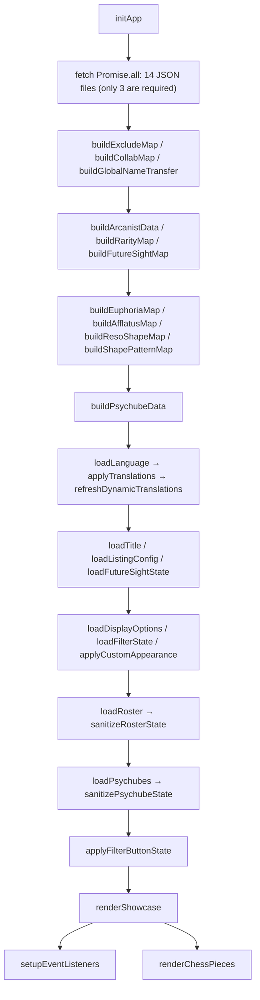

# Sotheby's Mansion (CharacterBox)

**Suitcase Showcase & Roster Tracker** for the game *Reverse: 1999*.

A static web app (Pure Vanilla JS + HTML5 + CSS3) that lets players:
- Track which Arcanists (characters) they own, and which Psychubes.
- Build a customizable showcase board / tier list (Resonance, Insight, Level, Portrait, Euphoria, Skin, Pattern, ...).
- Filter, search, and bulk-edit characters and Psychubes quickly.
- Export a high-resolution PNG to share, or back up / restore data as JSON.
- Switch the UI between **English, Chinese and Vietnamese**.

> **Live site:** [sothebymansion.com](https://sothebymansion.com)

> ⚠️ **Sotheby's Mansion is not affiliated with BluePoch.** All game images and data belong to their respective owners.

---

## Table of Contents

1. [TL;DR for AI agents](#0-tldr-for-ai-agents)
2. [Features](#1-features)
3. [Tech stack & architecture](#2-tech-stack--architecture)
4. [Directory structure](#3-directory-structure)
5. [Setup & running](#4-setup--running)
6. [Data architecture & state](#5-data-architecture--state)
7. [Game rules encoded in the app](#6-game-rules-encoded-in-the-app)
8. [Main modules in `app.js`](#7-main-modules-in-appjs)
9. [Internationalization (i18n)](#8-internationalization-i18n)
10. [Adding / updating a character](#9-adding--updating-a-character)
11. [Development rules](#10-development-rules)
12. [Technical notes & gotchas](#11-technical-notes--gotchas)

> Note: Psychube (chube) support is a first-class part of the app. For the quickest orientation, read [§0](#0-tldr-for-ai-agents) and [§7.2](#72-rule-engine-details) — the two card systems are *not* symmetric.

---

## 0. TL;DR for AI agents

Read this section first. It gives you everything needed to navigate the codebase fast.

- **Three core files only.** `index.html` (markup + all modals), `styles.css` (all styling), `app.js` (all logic, ~8,300 lines). No build step, no framework, no npm.
- **Only external dependency:** `html2canvas@1.4.1` via jsDelivr CDN (PNG export) plus Google Fonts. Everything else is native browser APIs.
- **Must be served over HTTP.** `app.js` calls `fetch()` on `data/*.json`, which fails under `file://`. Use `python -m http.server` or `npx serve`.
- **All user state lives in `localStorage`.** Keys are prefixed `r1999_` (see [§5.1](#51-localstorage-keys)). Preserve backward compatibility when changing schemas.
- **All app state lives in module-level variables** in `app.js` (e.g. `userRoster`, `userPsychubes`, `displayOptions`, `listingConfig`). There is no store / observer pattern — after mutating state you must call the relevant render + save function manually.
- **Single entry point:** `initApp()` at the bottom of `app.js`. It fetches 14 JSON files in parallel, builds lookup maps, loads state from `localStorage`, then calls `renderShowcase()` and `setupEventListeners()`.
- **Character names are the primary key** throughout the app (rosters, maps, tier rules). Storage always keeps the **English** name; only the *rendered label* changes with language (`displayCharName`).
- **Two parallel card systems.** Characters and Psychubes (chubes) render as sibling card types on the *same* board. Characters are keyed by **name**; chubes by a **`"<rarity>:<id>"` key** (`psychubeKey()`). They have separate rule evaluators — see [§7.2](#72-rule-engine-details).
- **Never read or scan `Reverse-1999-CN-Asset/` or `references/`** — huge asset/reference folders, git-ignored, and reading them will blow up your context window.

Common task → where to look:

| Task | File / function |
|------|-----------------|
| Change how character cards render | `createCharacterCard()` in `app.js` |
| Change how psychube cards render | `createPsychubeCard()` in `app.js` |
| Change the Team Recommendation logic | `recommendableVariantsForTeam()`, `applyRecommendedVariant()` |
| Change board layout / tiers | `renderShowcase()`, `renderTierRowSection()` |
| Change the character tier rule logic | `evalSingleCondition()`, `matchesTierRule()` |
| Change the psychube tier rule logic | `evalPsychubeCondition()`, `matchesPsychubeRule()` |
| Change the character edit modal | `openEditModal()`, `updateModalView()`, `saveEditModal()` |
| Change the psychube edit modal | `openPsychubeModal()`, `updatePsychubeModalView()`, `savePsychubeModal()` |
| Change styling/theme options | `DEFAULT_THEME_APPEARANCE`, `applyCustomAppearance()` |
| Change PNG export | `btnExportImage` click handler (`html2canvas` call) |
| Change JSON import/export | `btnExportJson*` handlers + `inputImportFile` handler |
| Change the Statistics modal | `buildStatsModel()`, `renderStatsModal()` |
| Change Team Building | `renderTeamModal()`, `renderTeamCard()`, `onTeamSlotClick()` |
| Change the team pickers | `renderTeamSelectCharacter()`, `renderTeamSelectPsychube()` |
| Change Team Presets | `renderTeamPresets()`, `presetVariantMembers()`, `data/team_archetypes.json` |
| Change the duplicate/Used marker | `duplicatedTeamCharacters()` |
| Add UI text / translation | `data/i18n.json` + `data-i18n` attributes in `index.html` |
| Add a character | [§9](#9-adding--updating-a-character) |
| Add a Psychube | [§9.1](#91-adding--updating-a-psychube) |
| Change the data editor | `editor/`, [editor/README.md](editor/README.md) |

---

## 1. Features

### 1.1. Showcase board & dynamic tiers
- The board (`#showcase-board`) groups owned characters into **tier rows** defined by the user's config (`listingConfig.tiers`).
- Default config sorts by **Resonance**: `R15`, `R11 - 14`, `R10`, `R1 - 9`, `Other`, `Unowned` — followed by the Psychube rows (`Other`, `Psychubes`, `Unowned`).
- Each tier contains **rule groups**: **OR** between groups, **AND** within a group.
- A card is placed into the **first matching tier**, evaluating top to bottom.
- Tiers can be added, deleted, cloned, reordered, hidden, and styled (label, text color, background, border, bold).
- System tiers (`Other`, `Unowned`, and the Psychube catch-alls) cannot be deleted; a safety net re-appends any owned chube that matched no tier.

### 1.2. Character card & edit modal
- Clicking a card opens the edit modal (`#edit-modal`):
  - **Status** — Owned / Unowned.
  - **Garment (Skin)** — pick a skin; the preview updates immediately.
  - **Insight** — I0–I3 (capped by rarity).
  - **Level** — slider; max depends on Insight.
  - **Resonance** — slider; max depends on Insight.
  - **Pattern** — resonance pattern picker; only enabled at R ≥ 10. A character can *own* several patterns but only one is the **main** pattern (drives colors).
  - **Portrait** — P0–P5.
  - **Euphoria** — E1 / E2; only shown when eligible.
  - **Favourite** — pin toggle beside the name (see [§1.4](#14-favourites-pinning)).

### 1.3. Quick Edit (Manage All)
- Grid modal (`#roster-modal`) for fast editing of many characters.
- **Select mode** enables multi-selection and **Bulk Apply** of one spec (Insight, Level, Resonance, Portrait, Ownership) across the selection.

### 1.4. Favourites (pinning)
- Toggle the pin in the edit modal (`#modal-btn-favourite`). Favourited characters sort to the **front of their tier**; among several favourites the normal ordering still applies.
- Purely cosmetic beyond sorting: a pin icon plus a dark corner wedge is drawn on the top-right of the portrait (`.char-favourite-badge` / `.char-favourite-corner`).
- Also usable as a tier rule field (`favourite` = true/false).

### 1.5. Psychubes (Chubes)
- Full tracking of Psychubes in parallel with characters: **Owned / Unowned**, **Level** (1–60), **Amplification** (A1–A5).
- **Special "count-only" chubes** (Gluttony / Greed, `id === 1` of each rarity) expose a raw **Quantity** instead of level/amp, bounded only by `PSYCHUBE_MAX_COUNT` (9999).
- Psychube cards render on the same board as character cards, driven by their **own** tier rows (`type: "psychube"`) and their **own** rule field set.
- Manager modal (`#chubes-modal`) with search + rarity filter, plus bulk apply (`#chube-bulk-modal`).
- State persisted under `r1999_psychube_v1`.

### 1.6. Team Building
- `#team-modal`, opened from the **Teams** button (`#btn-team`, `images/random_icon/Team_icon.png` + label) that closes the secondary tools row on the right, beside *JSON* / *Reset*.
- Each team is a **4-slot** card: a renameable title, four slots, and a delete button. Teams are stored under `r1999_teams_v1`.
- **Teams per row** — a `3 / 2 / 1` selector beside the Presets button writes `--team-columns` on `#team-list`. Each option is only *offered* when the viewport can host it (`TEAM_COLUMN_MIN_VIEWPORT`, evaluated by `maxTeamColumnsForViewport()`), and the modal widens for the 3-column layout (`TEAM_MODAL_MAX_WIDTH`). The preference is persisted as `columns` and re-clamped on resize by `applyTeamColumns()`.
- **Recommend** — when a team already fields the `is_essential` member of some preset, a 📖 button appears **to the left of the delete button** and opens the **Team Recommendation** modal (§1.8.1).
- **Hide Warning** — a toggle beside *Show Unowned* (`#btn-team-hide-warning`, persisted as `hideWarning`) that suppresses **every** Used marker: team slots, Team Presets, Team Recommendation, the Select Character picker and the board card. Turning it on sets `teamModalDirty` so the board repaints on close.
- **Slot anatomy** — the portrait (with the insight icon + level on a dark bottom band and the afflatus emblem in the top-left corner) and the **psychube block are separate siblings**, so hovering the character frames the character only. Unowned characters show neither insight nor level. Clicking the psychube block opens Select Psychube.
- A **drag handle** (`#team-strip-resizer`, also keyboard-resizable) splits the modal between the team list and the bottom strip; the ratio persists.
- The bottom strip lists **characters not used in any team**. Clicking a tile arms it (orange glow), then clicking a slot drops it in. Clicking an armed tile again disarms it.
- **Show Unowned** (`#btn-team-allow-unowned`) reveals unowned characters/psychubes, dimmed with the same opacity as the main board.
- **Used marker** — a character fielded by **two or more** teams gets `Used_icon.png` on a dark plate with a red border. The same marker appears on the main board card.
- **Team rules:** a character and a psychube may each appear **at most once per team**. Teams containing CN-only content are hidden while Future Sight is off.

### 1.7. Select Character / Select Psychube
- `#team-select-char-modal` / `#team-select-chube-modal`, opened from a slot (or its psychube tile).
- **Select Character** — one pick fills the slot and closes the modal. Characters already in the target team are hidden; a click on an occupied slot clears it instead.
- **Select Psychube** — mirrors the character picker but shows only **owned** psychubes unless Show Unowned is on, and never shows the Used marker.
- Both default to the ✦6 rarity filter only, with ✦5/4/3/2 off.
- Special count-only chubes (Gluttony / Greed) are excluded.

### 1.8. Team Presets
- `#team-presets-modal`, opened from **Presets**. Source data: `data/team_archetypes.json`.
- Shape: `{ presetName: [ [ { character, psychube, is_essential?, euphoria?, substitutes? }, ... ], ... ] }` — the **outer array holds same-name variants**, collapsed behind a chevron by default.
- **CN fallback** — with Future Sight off, a member whose primary is CN-only is replaced by its **first global substitute**, which is *promoted* into the primary slot (`resolvePresetVariant()`). So an archetype authored around a CN unit still appears on Global as long as every CN slot has a global alternative; a CN slot with none makes the whole variant unavailable.
- A variant is dropped if any member fails to resolve, or if it contains CN-only content while Future Sight is off.
- **Formable Only** keeps only variants where every slot is satisfiable — the primary *or* any substitute is owned (`memberIsFormable()`).
- The search box matches the preset name **or any member's name**.
- **Add** copies the variant into a new, independent team (no link back to the preset). Each slot is filled by `preferredVariantChoice()` (see §1.8.1).
- **`euphoria` chip** — a member may declare `"euphoria": "E1"`. It is a display chip **and a Future-Sight gate**: when that tier is CN-only for that character, the chip is hidden while Future Sight is off (`presetMemberEuphoria()`). So a comp needing Matilda's E2 simply does not advertise it on the Global build. Accepts `"E1"`, `"e1"` or `"1"`.
- **Used marker** — Team Presets flags a character fielded by **one or more** teams (so the board reads as a whole). Team Recommendation flags a character held by **any other** team but never the team being recommended for. Both are driven by `usedMarkerSet()`; threshold 1 here, unlike the team-slot marker's 2.
- **Substitutes** — a member may list interchangeable alternatives (`substitutes`). They render as portrait chips under the primary member behind an `or` label, in **both** Team Presets and Team Recommendation.
- **Layout** — the body is a **grid of archetype blocks** (`repeat(auto-fill, minmax(500px, 1fr))`), so **two archetypes share a row** on a desktop modal and it drops to one when narrow. Variants of the *same* archetype stack vertically inside their block.
- Each `.preset-row` is sized to its own content, so the **Add** button hugs the right edge of its team box, and it carries the same gradient surface as a Team Building card (`--team-card-bg`).
- Essential members get a red portrait frame (`.preset-member.is-essential`).
- The action button carries `margin-left: auto`, so it parks against the **right edge** of the team box instead of sitting right after the members.

### 1.8.1. Team Recommendation
- `#team-recommend-modal`, opened by the **Recommend** button on a team card (`openTeamRecommend()`).
- Lists only the presets whose **`is_essential` member is already fielded by that team** — i.e. `recommendableVariantsForTeam()` intersects each variant's essentials with the team's characters.
- Renders through the same `renderArchetypeBlocks()` helper as Team Presets, with the action button labelled **Use** instead of Add, and shares the same archetype-per-row grid.
- **Use** fills the team **in place** (no new team is created) via `applyRecommendedVariant()`: essentials are placed first and are never displaced, existing non-essential members are kept when a slot allows, and `sanitizeTeamsState()` re-runs afterwards so the one-character / one-psychube-per-team rules still hold.
- **Slot filling** (`preferredVariantChoice()`, shared with the Presets **Add** button) prefers **characters that are not in any team yet**, so adding a comp spreads across the roster:
  1. the primary member, when owned **and** fielded by no team;
  2. the first substitute that is owned **and** fielded by no team;
  3. fallback — the plain owned preference (primary, else first owned substitute, else the primary even when unowned). This is the "original team as authored" behaviour, used once every option is already taken.
  - An `is_essential` member is **never** swapped for a substitute — the archetype requires that exact character.
- Has its own search box (`#team-recommend-search`) and shares the **Formable Only** flag with Team Presets.

### 1.9. Filters & search
- Search by name, with **aliases** for special characters (`37`, `6`, `J`, `Avgust`, `Vila`, `Ezra`, ...) — see `NAME_ALIASES`.
- **Ownership** filter: All / Owned / Unowned — applies to **both** character and psychube tiers.
- **Rarity** filter: ✦6, ✦5, ✦4, ✦3, ✦2.

### 1.10. Statistics modal
- `#stats-modal` (`buildStatsModel()` → `renderStatsModal()`) — sections in render order:
  1. **Characters** — owned/total, the chess-piece progress row, and a note that collab characters are included.
  2. **Max Level** — count of owned characters at Level 60.
  3. **Euphorias** — coverage for rarities 6 and 5, counted **per tier** (a character with E1+E2 contributes 2).
  4. **Total R10** — owned characters at Resonance ≥ 10, per rarity.
  5. **Over-Investment** — count of owned characters at Resonance ≥ 11.
  6. **Pattern Unlocked** — owned characters whose main pattern is not `Placidity`, per rarity.
  7. **Psychubes** — owned/total, plus special (Gluttony / Greed) quantities and per-rarity counts.
  8. **Psychube Lv60** — owned chubes at Level 60, per rarity (6 / 5).
  9. **Psychube Max Amp** — owned chubes at A5, per rarity.
- Collab characters **are** counted here, even though the board's chess pieces exclude them.
- Special count-only chubes are excluded from every ratio.

### 1.11. Styling / customization
- Board background color, custom uploaded background image, board title.
- Board font, text sizes, borders, radius, opacity, spacing.
- Card size, character name color, Insight/Level badge, pattern colors, per-rarity portrait bar colors.
- Psychube coloring: level, amplification, max amplification, Gluttony/Greed quantity.
- **Unowned Characters / Psychubes Dimming** — the `Opacity` slider writes `appearance.unownedOpacity`, which `applyCustomAppearance()` pushes into the `--unowned-char-opacity` CSS variable. Default is **0.35** (`DEFAULT_THEME_APPEARANCE`), and every fallback in `app.js`/`styles.css`/`index.html` mirrors it so a fresh install and a reset both land on 35%.
  - It applies to unowned **characters and psychubes alike**, on the board, in the team slot, in Team Presets and in Team Recommendation. The psychube surfaces need an explicit `.is-unowned` class on the psychube block (`.team-slot-chube` / `.preset-member-chube`), added at render time from `getPsychubeState(key).owned` — the character's own ownership is irrelevant there.
- **Chess Pieces** — ownership progress per rarity (Rook ✦2 → Queen ✦6), toggleable with position/size/opacity controls.
- Display toggles to hide whole tier kinds (`hideCharacterTier`, `hidePsychubeTier`) and individual card details.

### 1.12. Import / Export
- **Export PNG** — `html2canvas` captures `#showcase-board` at high quality, skipping every `.no-export` element. Handles mobile/iOS specifics (4096px canvas limit, Web Share API, preview modal for saving to Photos).
- **Export JSON** — three modes: Theme Only, Roster Only, Export All (full backup).
- **Import JSON** — auto-detects four formats: theme-only, roster-only, full backup v2, and legacy v1 roster map.
- ⚠️ JSON export/import covers **characters only** — `userPsychubes` is *not* included in any payload. See [§11.8](#118-psychubes-are-absent-from-json-export).

### 1.13. Future Sight (CN content)
- Toggle display of characters / Euphorias / skins / Psychubes that only exist on the Chinese server.
- Source data: `data/future_sight.json`; state persisted under `r1999_future_sight_v1`.

### 1.14. Localization
- Full **EN / CN / VI** support for both UI strings and character/skin names.

---

## 2. Tech stack & architecture

- **Pure Vanilla JS** — no React/Vue/Svelte, no bundler (no Vite/Webpack).
- Only three core files: `index.html`, `styles.css`, `app.js` (~8,200 lines of JS).
- Static JSON data in `data/`, loaded with `Promise.all` + `fetch`.
- User state persisted in **`localStorage`** (two independent stores: characters and psychubes).
- Pure static site → deployable to any static host (GitHub Pages via `CNAME`).

Architectural constraints to keep in mind:
- Because of `fetch()`, the app **requires an HTTP server** — do not open `index.html` directly.
- Rendering is **imperative and manual**: mutate state → call the render function yourself.
- There is no component system; DOM is built with `document.createElement` and template strings.
- Cards are plain DOM with **absolutely-positioned overlay children** (tooltips, badges, pins). Anything that creates a stacking context on a container will silently reorder those overlays — see [§11.3](#113-chess-pieces).

---

## 3. Directory structure

```text
characterBox/
├── .gitignore                      # Ignores Reverse-1999-CN-Asset/ and references/
├── CNAME                           # sothebymansion.com
├── robots.txt                      # Keeps /editor/ out of search results
├── serve.py                        # Dev server: no-cache for text assets
├── package.json                    # Dev-only deps (playwright, for the UI tests)
├── index.html                      # Markup, all controls and modals
├── styles.css                      # All CSS
├── app.js                          # All application logic
├── README.md                       # This file
├── editor/                         # Static data editor (edit data/*.json with icons)
│   ├── index.html                  #   Five tabs: Characters, Psychubes, Team Presets, Patterns, Review
│   ├── editor.css                  #   Reuses the app's palette, fonts and icons
│   ├── json-patch.js               #   Range-aware JSON patcher — keeps diffs minimal
│   ├── model.js                    #   Data model, name resolution, validation
│   ├── icons.js                    #   Psychube icon compositing (port of testCodeChube/compose.py)
│   ├── frame.png                   #   The rarity frame the icons are composited onto
│   ├── files.js                    #   Reads the data, packages changes as a ZIP download
│   ├── app.js                      #   UI
│   └── README.md                   #   How to run it
├── data/                           # Game data (JSON)
│   ├── ArcanistMap.json            # Array of character metadata (id, names, live2d/skins)
│   ├── characters_by_rarity.json   # Grouped by rarity (6★ → 2★)
│   ├── characters_by_afflatus.json # Grouped by afflatus (Beast, Plant, Star, Mineral, Spirit, Intellect)
│   ├── character_reso_shape.json   # Resonance shape per character (Z/U/T/Plus)
│   ├── shape_patterns.json         # Patterns available per shape (USED by the app)
│   ├── reso_shape.json             # Duplicate of shape_patterns.json (NOT used by the app)
│   ├── euphoria_list.json          # Euphoria-capable characters + effect names per tier
│   ├── exclude_character.json      # Characters excluded from the app entirely
│   ├── collab_character.json       # Collab characters (excluded from board chess pieces only)
│   ├── global_name_transfer.json   # raw ArcanistMap name → canonical display name
│   ├── future_sight.json           # CN/Future content (Character, Euphoria, Skin, Psychube)
│   ├── i18n.json                   # UI strings for en / cn / vi (396 keys each)
│   ├── psychube_id.json            # Psychube (Chube) metadata: { "6": [...], "5": [...] }
│   ├── team_archetypes.json        # Team Presets: { name: [ [ {character, psychube} ] ] }
│   └── name_map.json               # EN → CN name maps for characters and skins
└── images/                         # Icons, avatars, UI art
    ├── headicon_small/             # Character & skin avatars
    ├── afflatus_icon/              # Afflatus icons
    ├── insight_icon/               # I0 – I3 icons
    ├── shape_pattern/              # Pattern icons, organized by shape folder
    ├── psychube_icon/              # Psychube icons, grouped by rarity folder
    ├── chess_pieces/               # Rarity progress pieces (empty/filled)
    ├── colour_references/          # Rarity line images (2–6)
    ├── random_icon/                # Misc UI icons (favourite / unfavourite / hide_tier, ...)
    └── ...
```

> ⚠️ `Reverse-1999-CN-Asset/` and `references/` **must not be read or scanned** (huge, git-ignored).
>
> ⚠️ The root-level `_*.png` files (`_fixed834.png`, `_overlap.png`, `_ph360.png`, ...) are **stray debug screenshots** that were committed by accident. They are not referenced anywhere in the app and are safe to delete.

---

## 4. Setup & running

The app fetches JSON, so it needs an HTTP server:

```powershell
# Python (recommended — serve.py disables caching for html/js/css/json)
python serve.py 8000

# or the stock server
python -m http.server 8000

# or Node.js
npx serve .
```

Then open `http://localhost:8000`.

**Deployment:** fully static — push to GitHub Pages. Custom domain is configured in `CNAME` (`sothebymansion.com`).

**Editing the game data:** open `http://localhost:8000/editor/index.html`, or the
deployed copy at `sothebymansion.com/editor/`. It presents one row per character
(newest first), lets you pick afflatus / rarity / resonance shape / psychubes by
clicking the game's own icons, imports a new psychube icon in one step instead of
running `testCodeChube/compose.py` by hand, validates before handing anything over,
and returns your changes as a ZIP to extract over the repository root — so
`git diff` stays limited to the lines you changed. It writes nothing to the host.
See [editor/README.md](editor/README.md). Editing the JSON by hand still works
exactly as described in [§9](#9-adding--updating-a-character).

---

## 5. Data architecture & state

### 5.1. LocalStorage keys

| Key | Contents |
|-----|----------|
| `r1999_character_roster_v2` | User roster: `{ [charName]: { owned, insight, level, resonance, portrait, e1, e2, skin, patterns, patternMain, boxKind, favourite } }` |
| `r1999_psychube_v1` | User psychubes: `{ ["<rarity>:<id>"]: { owned, level, amplification, count } }` |
| `r1999_teams_v1` | Team Building: `{ teams: [{ id, name, slots: [{ character, psychube }] }], allowUnowned, formableOnly, hideWarning, stripRatio, columns }` |
| `r1999_board_title_v1` | Board title (default `"Suitcase"`) |
| `r1999_tier_listing_v1` | Tier config: `{ tiers: [{ id, label, color, bgColor, borderColor, bold, type, hidden, ruleGroups }], psychubeTiersSeeded, unownedAbovePsychubeMigrated }` |
| `r1999_display_options_v1` | Visibility flags + `appearance` (all colors / typography / spacing) |
| `r1999_future_sight_v1` | Future Sight toggle |
| `r1999_filters_v1` | Filter state (ownership + rarity) |
| `r1999_language_v1` | Active language (`en` / `cn` / `vi`) |

> `boxKind` is a **legacy** field kept in sync with `patternMain` for backward compatibility (see `normalizePatternState`).

### 5.2. Static data (`data/*.json`)

1. **`ArcanistMap.json`** — an **array** of character entries. Each has `id`, `name`, `nameEng`, and `live2d[]` (skins, each with `id`, `characterSkin`, `characterSkinNameEng`, `des`).
   - Entries with `id === 9998` are skipped.
   - Skin ids longer than 6 chars are filtered out.
   - A skin is considered *default* when: index 0, `des === "初始皮肤"`, or the id ends in `01`.
   - Character name priority: `CANONICAL_NAME_OVERRIDES[id]` → `nameEng` → `name`.
2. **`characters_by_rarity.json`** — `{ "6": [...], "5": [...], ... }`.
3. **`characters_by_afflatus.json`** — `{ "Beast": [...], ... }`. Special key `Mineral_Star` for hybrid characters (satisfies both Mineral and Star).
4. **`character_reso_shape.json`** — `{ "Z shape": [...names], "U shape": [...], ... }`.
5. **`shape_patterns.json`** — `{ "Z shape": ["Placidity", "Elucidation", ...], ... }`.
6. **`euphoria_list.json`** — `{ "1": ["Name: Effect Name", ...], "2": [...] }`.
7. **`future_sight.json`** — `{ Character: [names], Euphoria: ["Name: tier", ...], Skin: [<skinId>, ...], Psychube: { "6": [id, ...], "5": [id, ...] } }`.
   - `Character` names go through `resolveCharacterName()`.
   - `Euphoria` entries use the literal `"Name: tier"` format (e.g. `"37: 1"`).
   - `Psychube` is a **nested object**, not a flat list — `{ rarity: [ids] }`.
8. **`exclude_character.json`** — array of fully excluded character names (currently `["Schneider"]`).
9. **`collab_character.json`** — array of collab character names (`The Twins`, `NORA`, `Ezio Auditore`, `Kassandra`, `Alexios`). These are **counted normally in the Statistics modal** but **excluded from the board's chess pieces** (`renderChessPieces()` only).
10. **`global_name_transfer.json`** — `{ rawArcanistMapName: displayName }` (e.g. `"Six" → "6"`, `"Changeling" → "Jessica"`). Consulted by `displayCharName()` after the CN translation and before the ArcanistMap English name.
11. **`psychube_id.json`** — `{ "6": [ ... ], "5": [ ... ] }`. Each array item has `id`, `name`, `nameCN`, `release_patch`, `tags`. Only rarities **6** and **5** exist.
    - `buildPsychubeData()` converts this into the internal `psychubeDb` keyed by `"<rarity>:<id>"`, deriving `iconUrl` as `images/psychube_icon/<rarity>/<id>.png` and normalizing `nameCN` → `nameCn`, `release_patch` → `releasePatch`.
    - Lists are stored **newest-id-first**; rarities are processed in the order `["6", "5"]`.
12. **`i18n.json`** — `{ en: {...}, cn: {...}, vi: {...} }`, 396 keys per language (all three must stay in sync).
13. **`name_map.json`** — `{ character: { EN: CN }, skin: { EN: CN } }`.
14. **`team_archetypes.json`** — Team Presets. Shape: `{ presetName: [ [ { character, psychube, is_essential?, euphoria?, substitutes? }, ... ], ... ] }`.
    - The **outer array holds same-name variants**; the UI collapses them behind a chevron.
    - `character` is resolved through `resolveCharacterName()`, `psychube` through `psychubeKeyByName()` (English or Chinese name → `"<rarity>:<id>"`).
    - `is_essential` marks the must-have member(s) of an archetype. It drives the **Recommend** button and is what `applyRecommendedVariant()` protects from being displaced.
    - `euphoria` is a **display chip** (e.g. `"E1"`) that **also acts as a Future-Sight gate** — it never writes to the roster, and it is hidden while Future Sight is off when the listed tier is CN-only for that character (`data/future_sight.json` → `Euphoria`).
    - **CN primaries fall back to a global substitute.** With Future Sight off, a member whose `character` is CN-only is replaced by its first non-CN substitute, promoted into the primary slot; the promoted entry is removed from `substitutes`. A CN primary with no global alternative drops the whole variant.
    - `substitutes` lists interchangeable alternatives for that slot: `[{ "character": "J", "psychube"?, "euphoria"? }, ...]`. A bare string (`"substitutes": ["J"]`) is accepted as shorthand. Order is preference order. An alternative with no `psychube` is filled **without** one — the player picks.
    - A variant whose **primary** members fail to resolve is dropped; a bad substitute is dropped on its own without killing the variant. A variant containing CN-only primary content is hidden while Future Sight is off, and CN-only substitutes are filtered out of the list.
    - ⚠️ This file must be **valid JSON** — a stray `{ "character": "X", "psychube" }` (no value) makes `JSON.parse` throw and silently disables **every** preset, since `fetch(...).catch(() => null)` swallows the failure.

### 5.3. Key state variables in `app.js`

| Variable | Meaning |
|----------|---------|
| `characterDb` | `{ name: "images/headicon_small/xxx.png" }` — default avatar |
| `characterRarityMap` | `{ name: rarity }` |
| `characterIdMap` | `{ name: id }` (aliases included) |
| `characterSkinsMap` | `{ name: [{ id, name, nameCn, isDefault, iconUrl }] }` |
| `characterAfflatus` | `{ name: afflatus }` |
| `characterResoShape` / `shapePatterns` | Resonance shape and its pattern list |
| `euphoriaOptionsByName` / `euphoriaNamesByTier` / `euphoriaAllowedNames` | Euphoria data |
| `futureSightChars` / `futureSightEuphorias` / `futureSightSkins` / `futureSightPsychubes` | CN content sets |
| `globalNameTransfer` | `{ rawName: canonicalName }` |
| `excludedCharacters` | Set of excluded names |
| `collabCharacters` | Set of collab names (excluded from chess pieces only) |
| `userRoster` | Current user roster (characters) |
| `psychubeDb` | `{ "6:1": { rarity, id, name, nameCn, tags, releasePatch, iconUrl } }` |
| `psychubeOrder` | Ordered keys for a stable listing |
| `userPsychubes` | `{ "6:1": { owned, level, amplification, count } }` |
| `listingConfig` | `{ tiers: [...], psychubeTiersSeeded, unownedAbovePsychubeMigrated }` |
| `displayOptions` | Visibility flags + `appearance` |
| `customBoardBgImageUrl` | Uploaded board background image (session-only, not persisted) |
| `tempEditState` | Scratch state for the character edit modal |
| `tempChubeState` | Scratch state for the psychube edit modal |
| `tempListingTiers` | Working copy of tiers inside the Tier Listing editor (committed on save) |
| `bulkSpec` | Pending spec for Bulk Apply |
| `teamArchetypes` | `{ presetName: [ [ { character, psychube, euphoria? } ] ] }` from `team_archetypes.json` |
| `teamsConfig` | `{ teams: [{ id, name, slots: [{ character, psychube }] }] }` |
| `teamsAllowUnowned` / `teamsFormableOnly` | The two Team Building toggles (persisted with the teams) |
| `teamStripRatio` | Share of the Team Building modal height given to the unused strip (persisted) |
| `pendingTeamCharacter` | Character armed in the unused strip, waiting for a slot click |
| `teamCollapsedGroups` | Preset names whose extra variants are collapsed |
| `teamColumns` | Preferred teams per row (clamped by the viewport) |
| `teamRecommendTeamId` / `teamRecommendSearch` | Team whose Recommend modal is open, and its search box |

---

## 6. Game rules encoded in the app

**Max Insight by rarity** — `getMaxInsightForRarity(rarity)`
- 5★ & 6★ → I3
- 4★, 3★, 2★ → I2

**Max Level by Insight** — `getMaxLevelForInsight(insight)`

| Insight | Max level |
|---------|-----------|
| I0 | 30 |
| I1 | 40 |
| I2 | 50 |
| I3 | 60 |

**Max Resonance by Insight** — `getMaxResonanceForInsight(insight)`

| Insight | Max resonance |
|---------|---------------|
| I0 | R1 |
| I1 | R5 |
| I2 | R10 |
| I3 | R15 |

**Other rules**
- **Portrait:** P0 – P5 (5 dashes shown on the card).
- **Euphoria:** E1 / E2; available only if the character is listed in `euphoria_list.json`, at **I3** and **Level ≥ 30**.
- **Pattern:** unlocked only at Resonance ≥ 10. `Placidity` is the implicit default and is **not** shown in the picker.
- **Pattern color:** each pattern belongs to a *colour family* (orange / green / yellow / blue / placidity) — see `PATTERN_COLORS` and `PATTERN_COLOR_FAMILY`.

**Psychube rules**
- **Level:** 1 – 60 (`PSYCHUBE_MAX_LEVEL`).
- **Amplification:** A1 – A5 (`PSYCHUBE_MIN_AMP` / `PSYCHUBE_MAX_AMP`).
- **Special chubes** — `id === 1` of each rarity (`PSYCHUBE_SPECIAL_IDS`), i.e. Gluttony / Greed. These track a raw **quantity** instead of level/amplification, capped at `PSYCHUBE_MAX_COUNT` (9999). `isSpecialPsychube()` is the predicate.
- Level and Amplification are only editable while the chube is **owned**.
- Special chubes are **excluded from every ratio** in the Statistics modal.

---

## 7. Main modules in `app.js`

Startup and render flow:



> Every `fetch` except `characters_by_rarity.json`, `ArcanistMap.json` and `euphoria_list.json` is wrapped in `.catch(() => null)`, and every `res.json()` is individually try/caught. A missing or malformed optional JSON therefore degrades that feature instead of breaking startup.

### 7.1. Function groups

| Group | Key functions |
|-------|---------------|
| **i18n** | `t`, `loadLanguage`, `setLanguage`, `applyTranslations`, `displayCharName`, `displaySkinName`, `refreshDynamicTranslations` |
| **Init & map building** | `initApp`, `buildArcanistData`, `buildRarityMap`, `buildAfflatusMap`, `buildResoShapeMap`, `buildShapePatternMap`, `buildEuphoriaMap`, `buildFutureSightMap`, `buildExcludeMap`, `buildCollabMap`, `buildGlobalNameTransfer`, `buildPsychubeData` |
| **Name normalization** | `normalizeCharacterKey`, `resolveCharacterName`, `CANONICAL_NAME_OVERRIDES`, `NAME_ALIASES` |
| **State & storage** | `loadRoster`, `saveRoster`, `sanitizeRosterState`, `loadPsychubes`, `savePsychubes`, `sanitizePsychubeState`, `loadListingConfig`, `saveListingConfig`, `loadDisplayOptions`, `saveDisplayOptions`, `applyCustomAppearance` |
| **Rule engine** | `evalSingleCondition`, `matchesTierRule`, `evalPsychubeCondition`, `matchesPsychubeRule`, `convertLegacyRuleToGroups`, `defaultTierCondition`, `isCharacterUnbuilt` |
| **Board rendering** | `renderShowcase`, `renderTierRowSection`, `createCharacterCard`, `createPsychubeCard`, `renderChessPieces` |
| **Sorting** | `compareCharacters` (owned), `compareUnownedCharacters` (by release id), `comparePsychubes` / `comparePsychubesUnowned`, `comparePsychubesSpecialFirst` / `comparePsychubesSpecialFirstUnowned`, `specialPsychubeRank` |
| **Character modal** | `openEditModal`, `updateModalView`, `renderSkinSelector`, `updateSkinSelectionUI`, `renderShapePatternGrid`, `togglePatternSelection`, `saveEditModal`, `closeEditModal`, `syncFavouriteButton` |
| **Psychube modal** | `openPsychubeModal`, `updatePsychubeModalView`, `savePsychubeModal`, `closePsychubeModal`, `getPsychubeState`, `psychubeKey`, `isSpecialPsychube`, `psychubeName`, `psychubeIconUrl`, `psychubeMatchesQuery` |
| **Quick Edit** | `openRosterModal`, `renderRosterManager`, `setRosterSelectMode`, `toggleRosterTileSelection`, `selectAllVisibleRosterTiles`, `applyBulkSpec` |
| **Psychube manager** | `openChubesModal`, `renderChubesManager`, `setChubesSelectMode`, `updateChubesSelectionUI`, `chubesVisibleKeys`, `openChubeBulkModal`, `renderChubeBulkModal`, `applyChubeBulkSpec` |
| **Statistics** | `buildStatsModel`, `renderStatsModal`, `openStatsModal`, `closeStatsModal`, `statsSpecialChubesHtml`, `statsChessHtml`, `statsBarHtml`, `statsRarityBlockHtml`, `statsValueRowHtml` |
| **Team Building** | `setupTeamBuildingListeners`, `setupTeamStripResizer`, `loadTeams`, `saveTeams`, `sanitizeTeamsState`, `renderTeamModal`, `renderTeamCard`, `renderTeamAddCard`, `teamSlotPortraitHtml`, `applyTeamColumns`, `maxTeamColumnsForViewport`, `effectiveTeamColumns`, `onTeamSlotClick`, `addTeam`, `deleteTeam`, `renameTeam`, `setTeamSlotCharacter`, `setTeamSlotPsychube`, `teamUnusedCharacters`, `teamCountForCharacter`, `duplicatedTeamCharacters`, `visibleTeams`, `teamHasFutureSightContent`, `nextEmptyTeamSlot`, `createTeam`, `createEmptyTeamSlots`, `normalizeTeamSlots`, `findTeam` |
| **Team Recommendation** | `openTeamRecommend`, `closeTeamRecommend`, `renderTeamRecommend`, `recommendableVariants`, `recommendableVariantsForTeam`, `recommendedVariantsForTeam`, `applyRecommendedVariant`, `teamCharacters` |
| **Team pickers** | `openTeamSelectCharacter`, `renderTeamSelectCharacter`, `closeTeamSelectCharacter`, `openTeamSelectPsychube`, `renderTeamSelectPsychube`, `closeTeamSelectPsychube` |
| **Team presets** | `buildTeamArchetypes`, `renderTeamPresets`, `renderArchetypeBlocks`, `presetNames`, `presetVariantMembers`, `resolvePresetVariant`, `normalizeSubstitutes`, `presetMemberEuphoria`, `presetVariantHasFutureSight`, `presetMemberCell`, `presetSlotCell`, `usedMarkerSet`, `openTeamPresets`, `closeTeamPresets`, `psychubeKeyByName` |
| **Variant choices** | `isCharacterOwned`, `memberIsFormable`, `preferredVariantChoice` |
| **Tier listing editor** | `renderListingTiersEditor`, `ensureTierRuleGroups`, `ensureSystemTiersInList`, `DEFAULT_TIERS_CONFIG` |
| **Export / Import** | `btnExportImage` handler (`html2canvas`), `btnExportJsonTheme/Roster/All`, `inputImportFile` handler |
| **Utilities** | `hexToRgba`, `escapeHtml`, `getBoardFontFamily`, `getPatternColor`, `getMainPattern`, `normalizePatternState`, `setupPatternTooltip`, `showConfirmModal` |

> `triggerDownload()` (JSON export) is a helper nested inside `setupEventListeners()` rather than a module-level utility.

### 7.2. Rule engine details

A tier looks like:

```js
{
  id: "tier_r15",
  label: "R15",
  color: "#d1783d",
  ruleGroups: [
    [ { field: "resonance", op: "=", value: 15 } ],
    [ { field: "insight", op: "=", value: 3 }, { field: "level", op: ">=", value: 60 } ]
  ]
}
```

- Evaluation: `(Group1 AND ...) OR (Group2 AND ...)` — implemented by `matchesTierRule()` for characters and `matchesPsychubeRule()` for chubes.
- An empty `ruleGroups` (or an empty group) means **match everything**.
- **Operators:** `=`, `!=`, `>=`, `<=`, `>`, `<` (`COMPARISON_OPS`). For `boolean` and `text` fields the operator selector is hidden and forced to `=`.

**Character tiers** — fields defined in `FIELD_DEFINITIONS`, evaluated by `evalSingleCondition(cond, char, rarity)`:

| Kind | Fields |
|------|--------|
| Numeric / select | `resonance`, `insight`, `level`, `portrait`, `rarity` |
| Boolean | `has_euphoria`, `has_pattern`, `has_skin`, `favourite` |
| Text | `afflatus` (with `Mineral_Star` satisfying both `Mineral` and `Star`), `name` (matches name / alias / substring) |

**Psychube tiers** — fields defined in `CHUBE_FIELD_DEFINITIONS`, evaluated by `evalPsychubeCondition(cond, chube, state)`:

| Kind | Fields |
|------|--------|
| Numeric / select | `level` (1–60), `amplification` (A5–A1), `rarity` (✦6–✦2) |
| Text | `tag` (e.g. `ATK`, `Critical`), `name` (matches EN / CN name) |

> ⚠️ The two field sets are **not interchangeable**. A character field such as `resonance` is meaningless on a psychube tier, which is why new rule rows are seeded through `defaultTierCondition(isChubeTier)` — `level = 60` for chube tiers, `resonance >= 10` for character tiers.

**Special tier types** (`tier.type`):

| Type | Meaning |
|------|---------|
| *(none)* | Ordinary rule-driven character tier |
| `"other"` | Catch-all for owned characters matching no tier above (system, not deletable) |
| `"unowned"` | Unowned characters (system, not deletable) |
| `"psychube"` | Rule-driven psychube tier |
| `"psychube_other"` | Catch-all for owned chubes matching no tier (system, not deletable) |
| `"psychube_unowned"` | Unowned chubes (system, not deletable) |

- `tier.hidden` drops a tier from the board without deleting it (`ensureSystemTiersInList()` re-seeds missing system tiers; `listingConfig.psychubeTiersSeeded` / `unownedAbovePsychubeMigrated` are one-shot migration flags).
- Backward compatibility: if a tier only has a legacy string `rule`, `convertLegacyRuleToGroups` converts it (supports `r15`, `r10_pattern`, `lv60`, `i3`, `rarity_6`, `unbuilt`, ...).

---

## 8. Internationalization (i18n)

- UI strings live in `data/i18n.json`, keyed as `namespace.key` (e.g. `toolbar.exportPng`, `setting.insight`, `pattern.offensive`).
- In HTML, use attributes:
  - `data-i18n` → `textContent`
  - `data-i18n-placeholder` → `placeholder`
  - `data-i18n-title` → `title`
  - `data-i18n-aria-label` → `aria-label`
- In JS, use `t("key")`, which supports `{var}` interpolation.
- Character / skin names come from `data/name_map.json` and only change when `currentLang === "cn"`. **Storage always keeps the English key.**
- The wordmark has localized artwork: `sotheby_mansion_cn.png`, `dinhthusotheby.png`, `sotheby_mansion.webp`.
- All three languages carry an **identical** key set. A key added to only one language falls back to the raw key string in the UI.
- Elements built after `applyTranslations()` (tier editors, modals, cards) are not covered by the `data-i18n` sweep — call `refreshDynamicTranslations()` or `t()` at build time.

---

## 9. Adding / updating a character

1. **Avatar / skin** — add images to `images/headicon_small/<skinId>.png`.
2. **`data/ArcanistMap.json`** — add a character entry with `id`, `name`, `nameEng`, and a `live2d[]` array.
3. **`data/characters_by_rarity.json`** — add the name under the matching rarity key.
4. **`data/characters_by_afflatus.json`** — add the name under the matching afflatus (use `Mineral_Star` for hybrids).
5. **`data/character_reso_shape.json`** — assign a resonance shape.
6. **`data/name_map.json`** — add the EN → CN mapping for the character / skins (if available).
7. **`data/euphoria_list.json`** — add the entry if the character has Euphoria (`"Name: Effect Name"`).
8. **`data/future_sight.json`** — add to `Character` / `Euphoria` / `Skin` / `Psychube` if CN-only.
9. **`data/exclude_character.json`** — add the name to remove it entirely.
10. **`data/collab_character.json`** — add the name if it is a collab character (excluded from chess pieces only).

Character names must match **exactly** across the JSON files (or be covered by an alias in `NAME_ALIASES`).

### 9.1. Adding / updating a Psychube

1. **Icon** — add the image at `images/psychube_icon/<rarity>/<id>.png`.
2. **`data/psychube_id.json`** — append to the `"6"` or `"5"` **array** an item with `id`, `name`, `nameCN`, `release_patch`, `tags`.
3. **`data/future_sight.json`** — add the id to `Psychube["<rarity>"]` if CN-only.

- The internal key is always `"<rarity>:<id>"` (`psychubeKey()`), and `iconUrl` is derived from those same two parts — so the entry, the rarity folder and the file name must all agree.
- `rarity` itself is not stored in the JSON: it comes from which top-level key the item sits under.
- `id === 1` of each rarity is reserved as a **special count-only** chube (Gluttony / Greed) — do not add normal chubes at that id.
- `userPsychubes` is created lazily and sanitized by `sanitizePsychubeState()`; only rarities **6** and **5** are supported.

---

## 10. Development rules

1. **No heavy frameworks** — stay Vanilla JS. Don't add npm dependencies or a bundler unless genuinely necessary.
2. **Backward compatibility** — when changing the state or tier-config schema in `localStorage`, always keep a migration/fallback so existing user data isn't broken.
   - Existing examples: `convertLegacyRuleToGroups`, `normalizePatternState` (legacy `boxKind` → `patterns` + `patternMain`), the `showRarityLine` migration, and the one-shot `psychubeTiersSeeded` / `unownedAbovePsychubeMigrated` flags in `ensureSystemTiersInList()`.
   - `sanitizeRosterState()` and `sanitizePsychubeState()` run on every load and are the right place for a new normalization step.
3. **DOM performance** — avoid unnecessary re-renders on filter/search; batch DOM updates. The board can hold hundreds of cards.
4. **CSS & responsiveness** — keep the existing class conventions in `styles.css`. Mind both desktop and the mobile drawer (`#btn-tools-toggle`, `#header-secondary-tools`).
5. **CSS stacking order** — before adding `opacity`, `transform`, `filter`, `will-change` or `z-index` to a *container*, check whether it wraps an absolutely-positioned overlay (tooltips, pins). Any of those properties creates a stacking context that can trap the overlay beneath later siblings — see [§11.3](#113-chess-pieces).
6. **File paths** — in HTML/JS/CSS always use `/` (`images/headicon_small/...`), even on Windows.
7. **Forbidden folders** — do **NOT** read or scan `Reverse-1999-CN-Asset/` or `references/`.
8. **Never mutate user data during render** — every roster change must go through `sanitizeRosterState()` + `saveRoster()`, and every psychube change through `sanitizePsychubeState()` + `savePsychubes()`.
9. **Keep i18n in sync** — `data/i18n.json` has three languages with an identical key set (396 each). Adding a key to one language without the others leaves untranslated UI.
10. **Keep the two rule field sets separate** — character fields and psychube fields are not interchangeable; seed new rows via `defaultTierCondition(isChubeTier)` ([§7.2](#72-rule-engine-details)).

---

## 11. Technical notes & gotchas

### 11.1. PNG export
- `html2canvas` clones the DOM; any element with class `.no-export` (toolbar, footer, tooltips) is omitted.
- Max canvas dimension is **4096px** (iOS WebKit limit) — scale is recalculated automatically.
- On mobile, a preview modal is shown so the user can save the image; iOS prefers Web Share API / long-press-to-save.

### 11.2. Patterns & resonance
- `Placidity` = the default pattern (no icon in the picker; fallback value for `boxKind`).
- The main pattern drives the **resonance badge color** and, if enabled, the **avatar background/border color**.
- Pattern images: `images/shape_pattern/<Shape>/<Pattern>.png`.

### 11.3. Chess pieces
- Ownership per rarity is shown by the "filled" portion of each piece (a `fill-mask` element with `top: %`). `clip-path` is deliberately **not** used — `html2canvas` cannot render it — hence the `overflow: hidden` mask.
- Can be positioned at the board header (`top`) or below the board (`bottom`).
- **Stacking-context trap.** `.chess-piece-wrapper[data-piece="Rook"|"Knight"|"Bishop"]` carry a `transform`, which creates a stacking context; a wrapper's children can never paint above a later sibling of the wrapper's *own* stacking context. Two rules keep the hover tooltip on top:
  1. `.chess-piece-wrapper:hover { z-index: 1000; }` — lifts the whole wrapper (and therefore its tooltip).
  2. The opacity fade lives on `.chess-piece-empty` / `.chess-piece-filled`, **not** on `.chess-pieces-container`. Putting `opacity < 1` on the container creates a stacking context that would trap the tooltip beneath the character cards.
  - Symptom if either rule is lost: the tooltip renders *behind* the character cards in the tier rows below the board header.

### 11.4. Favourite pin & corner wedge
- `.char-favourite-badge` (the pin) sits at `z-index: 4`; `.char-favourite-corner` (a `border-top` + transparent `border-left` triangle, `rgba(0,0,0,0.55)`) sits at `z-index: 3` so it lands **below** the pin and below the portrait's frame.
- The wedge is inset by `1px` on `top`/`right` so the portrait's 1px border keeps painting on top of it.
- Its size is derived from the avatar size: `calc(var(--char-avatar-size, 60px) * 16 / 60)` — i.e. a 16px leg on a 60px card, scaling with the card-size slider.
- The wedge is what makes the pale pin legible over bright portrait art; removing it makes favourited cards look like they have no marker at all on light backgrounds.
- ⚠️ The board badge currently renders `images/random_icon/unfavourite_icon.png`, which is the favourite pin **with a slash through it** — so favourited cards display a "not favourite" glyph. `favourite_icon.png` (the unmarked pin) is only used by the modal button. This looks like a swapped asset rather than intent; fixing it is a one-line change in `createCharacterCard()` (`favouriteBadgeHtml`).

### 11.5. `reso_shape.json` is dead data
- `data/reso_shape.json` and `data/shape_patterns.json` are **byte-identical**.
- The app only fetches `shape_patterns.json`. `reso_shape.json` is a stale leftover and is not loaded.

### 11.6. Local development caching
- `python -m http.server` sends **no `Cache-Control` header**, so browsers heuristically cache `styles.css` / `app.js`. After editing CSS you may need a hard reload (Ctrl+Shift+R) or a cache-busting query string, otherwise you will be inspecting stale rules while debugging.
- When verifying CSS changes, read `document.styleSheets[...].cssRules` (or the resolved `getComputedStyle` value) — a stylesheet can be served correctly while the *rendered* page still uses the cached copy.

### 11.7. Edge cases
- Characters with id `9998` are skipped when building data.
- `The Twins` is a hybrid character (`Mineral_Star`).
- `exclude_character.json` currently excludes `Schneider` from the app (even though the name still appears in some source data files).
- Collab characters (`collab_character.json`) are excluded from the board's chess pieces **only** — they still count in Statistics.
- Some inline comments in `app.js` are Vietnamese with **mojibake** (broken encoding, e.g. `// 1. Export Theme Only (Không bao gồm roster...)`). This is a pre-existing encoding artifact, not intentional content.
- `data/global_name_transfer.json` also contains mojibake keys (Cyrillic names decoded as Latin-1). Those keys are the raw `ArcanistMap` values, so they must **not** be "fixed" without also updating the source.

### 11.8. Psychubes are absent from JSON export
- `userPsychubes` is **not** included in any of the three JSON export payloads (Theme Only / Roster Only / Export All) and is **not** read back by `inputImportFile`.
- A "full backup" therefore restores characters, tiers and theme, but silently drops every psychube. Treat this as a known gap, not intended behaviour.
- `r1999_teams_v1` is likewise **not** part of the JSON export/import cycle.

### 11.9. Team Building layout constraints
- The modal is a fixed-height flex column: `.team-list-wrap` (`flex: 1 1 auto`, scrolls) over `.team-unused-wrap` (`height: calc(var(--team-strip-ratio) * 100%)`). The drag handle writes `--team-strip-ratio` on `.team-body`.
- **`--team-strip-ratio` is measured from the bottom**, because the strip is pinned there. When touching `setupTeamStripResizer()`, keep the `(rect.bottom - clientY) / rect.height` direction or the drag will feel inverted.
- A team slot is `aspect-ratio: 3 / 2` and splits `66.7%` portrait / `33.3%` psychube. The psychube block is border-less until hovered — do not "fix" it by adding a resting frame.
- The psychube art is **never stretched**: its box carries `aspect-ratio: 180 / 214` (the native icon size) and `align-self: flex-end`, so it keeps the real proportions and sits on the slot's bottom edge. The same treatment applies to `.preset-member-chube` in Team Presets.
- `#team-unused-grid` is a **grid with `auto-fill`**, not `flex-wrap` — every column is the same width, so no ragged dead strip is left at the right edge. That is why `.team-unused-tile` no longer sets its own `width`.
- ⚠️ **Both team grids need `grid-auto-rows: max-content`.** With the default `auto`, a grid whose content overflows its box does not scroll: the Grid squeezes every row down to fit (a 70-tile strip collapsed to 5 rows of 27px, crushing each tile into a sliver), which reads as "icons overlapping". `grid-auto-rows: max-content` keeps rows content-sized so the `overflow-y: auto` parent actually scrolls. This applies to `#team-unused-grid` **and** `#team-list`.
- Team cards must stay free of `transform`/`filter` on hover: those create stacking contexts that would trap the `.team-slot-used` badge.
- **Teams** is a labelled `.btn` inside the drawer's data group, not a fixed-size square, so it simply follows the group's height. Its icon shrinks to 15px / 14px in the tablet and phone media queries.
- ⚠️ **Unowned-psychube dimming needs two classes.** `.team-slot-chube img` / `.preset-member-chube img` are (0,1,1), so the dimming rule must be written as `.team-slot-chube.is-unowned img` (0,2,1) — a bare `.is-unowned img` would lose.
- `filter: none` on `.chube-card .chube-avatar-img` is currently **dead**: `.char-avatar-box img.char-avatar-img` (0,2,1) outranks it (0,2,0), so board chube art still gets the character saturation filter. Pre-existing and cosmetic; leave it alone unless chube art is being reworked.

### 11.10. Duplicate ("Used") marker semantics
- `duplicatedTeamCharacters()` returns characters present in **two or more distinct teams**. A character fielded by exactly one team is *not* marked.
- The marker is rendered in **five** places that must stay consistent: the main board card (`.char-used-badge`), the Select Character picker (`.team-used-badge`), the team slot itself (`.team-slot-used`), and now the preset member (`.preset-member-used`) and preset substitute chip (`.preset-sub .preset-sub-used`) in Team Presets + Team Recommendation.
- `.team-slot-used` is anchored to `.team-slot-char` (which is now exactly the portrait box), so it uses a plain `right: 2px`. It used to offset by `33.3%` because the portrait and the psychube shared one button; the two are separate siblings now.
- `.preset-member-badges` is placed **inside** `.preset-member-portrait` (not on `.preset-member`, which also spans the psychube area) so the badge lands on the portrait corner like everywhere else, and so it stacks beside the euphoria chip instead of overlapping it.
- **Marker scope differs per surface.** `usedMarkerSet(exceptTeamId)` returns characters fielded by any team *except* `exceptTeamId`, or an empty set when *Hide Warning* is on. Team Presets calls it with `null` (any team counts); Team Recommendation calls it with `teamRecommendTeamId` (the team you are recommending for is not a conflict). The team-slot and picker markers still use the stricter `duplicatedTeamCharacters()` (>= 2 teams), because a character sitting in the slot you are looking at is not a warning.
- ⚠️ `.preset-sub .preset-sub-used` is deliberately **two classes deep**: a plain `.preset-sub-used` loses to `.preset-sub img` (0,1,1) and would get stretched to the chip's full 22px.
- Because the badge depends on `teamsConfig`, `renderShowcase()` must run after any team edit — that is what `teamModalDirty` defers until the modal closes.

---

## Credits

- **Icon Artist:** ena.
- **Developed by:** sh, assisted by 91.
- Sotheby's Mansion is not affiliated with BluePoch. All images and data belong to their respective owners.
