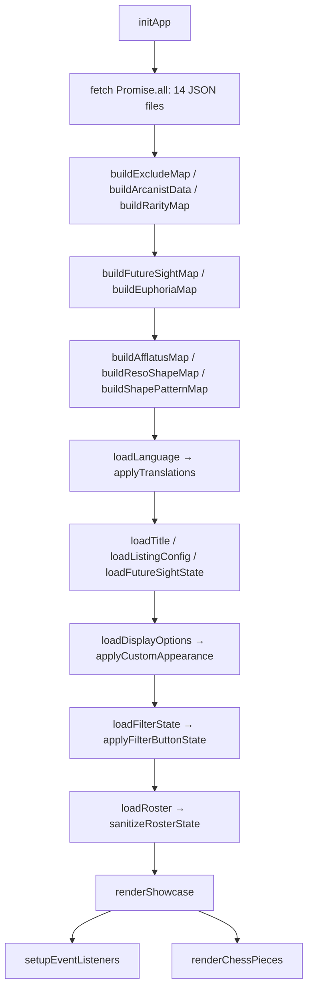

# Sotheby's Mansion (CharacterBox)

**Suitcase Showcase & Roster Tracker** for the game *Reverse: 1999*.

A static web app (Pure Vanilla JS + HTML5 + CSS3) that lets players:
- Track which Arcanists (characters) they own.
- Build a customizable showcase board / tier list (Resonance, Insight, Level, Portrait, Euphoria, Skin, ...).
- Filter, search, and bulk-edit characters quickly.
- Export a high-resolution PNG to share, or back up / restore data as JSON.

> **Live site:** [sothebymansion.com](https://sothebymansion.com)

> ⚠️ **Sotheby's Mansion is not affiliated with BluePoch.** All game images and data belong to their respective owners.

---

## Table of Contents

1. [TL;DR for AI agents](#0-tldr-for-ai-agents)
2. [Features](#1-features)
3. [Tech stack & architecture](#2-tech-stack--architecture)
4. [Directory structure](#3-directory-structure)
5. [Setup & running](#4-setup--running)
6. [Data architecture & state](#5-data-architecture--state)
7. [Game rules encoded in the app](#6-game-rules-encoded-in-the-app)
8. [Main modules in `app.js`](#7-main-modules-in-appjs)
9. [Internationalization (i18n)](#8-internationalization-i18n)
10. [Adding / updating a character](#9-adding--updating-a-character)
11. [Development rules](#10-development-rules)
12. [Technical notes & gotchas](#11-technical-notes--gotchas)

---

## 0. TL;DR for AI agents

Read this section first. It gives you everything needed to navigate the codebase fast.

- **Three core files only.** `index.html` (markup + all modals), `styles.css` (all styling), `app.js` (all logic, ~5400 lines). No build step, no framework, no npm.
- **Only external dependency:** `html2canvas@1.4.1` via jsDelivr CDN (PNG export) plus Google Fonts. Everything else is native browser APIs.
- **Must be served over HTTP.** `app.js` calls `fetch()` on `data/*.json`, which fails under `file://`. Use `python -m http.server` or `npx serve`.
- **All user state lives in `localStorage`.** Keys are prefixed `r1999_` (see [§5.1](#51-localstorage-keys)). Preserve backward compatibility when changing schemas.
- **All app state lives in module-level variables** in `app.js` (e.g. `userRoster`, `displayOptions`, `listingConfig`). There is no store / observer pattern — after mutating state you must call the relevant render + save function manually.
- **Single entry point:** `initApp()` at the bottom of `app.js`. It fetches 14 JSON files in parallel, builds lookup maps, loads state from `localStorage`, then calls `renderShowcase()` and `setupEventListeners()`.
- **Character names are the primary key** throughout the app (rosters, maps, tier rules). Storage always keeps the **English** name; only the *rendered label* changes with language (`displayCharName`).
- **Never read or scan `Reverse-1999-CN-Asset/` or `references/`** — huge asset/reference folders, git-ignored, and reading them will blow up your context window.

Common task → where to look:

| Task | File / function |
|------|-----------------|
| Change how cards render | `createCharacterCard()` in `app.js` |
| Change board layout / tiers | `renderShowcase()`, `renderTierRowSection()` |
| Change the tier rule logic | `evalSingleCondition()`, `matchesTierRule()` |
| Change the character edit modal | `openEditModal()`, `updateModalView()`, `saveEditModal()` |
| Change styling/theme options | `DEFAULT_THEME_APPEARANCE`, `applyCustomAppearance()` |
| Change PNG export | `btnExportImage` click handler (`html2canvas` call) |
| Change JSON import/export | `btnExportJson*` handlers + `inputImportFile` handler |
| Add UI text / translation | `data/i18n.json` + `data-i18n` attributes in `index.html` |
| Add a character | [§9](#9-adding--updating-a-character) |

---

## 1. Features

### 1.1. Showcase board & dynamic tiers
- The board (`#showcase-board`) groups owned characters into **tier rows** defined by the user's config (`listingConfig.tiers`).
- Default config sorts by **Resonance**: `R15`, `R11 - 14`, `R10`, `R1 - 9`, `Other`, `Unowned`.
- Each tier contains **rule groups**: **OR** between groups, **AND** within a group.
- A character is placed into the **first matching tier**, evaluating top to bottom.
- Tiers can be added, deleted, cloned, reordered, and styled (label, text color, background, border, bold).

### 1.2. Character card & edit modal
- Clicking a card opens the edit modal (`#edit-modal`):
  - **Status** — Owned / Unowned.
  - **Garment (Skin)** — pick a skin; the preview updates immediately.
  - **Insight** — I0–I3 (capped by rarity).
  - **Level** — slider; max depends on Insight.
  - **Resonance** — slider; max depends on Insight.
  - **Pattern** — resonance pattern picker; only enabled at R ≥ 10. A character can *own* several patterns but only one is the **main** pattern (drives colors).
  - **Portrait** — P0–P5.
  - **Euphoria** — E1 / E2; only shown when eligible.

### 1.3. Quick Edit (Manage All)
- Grid modal (`#roster-modal`) for fast editing of many characters.
- **Select mode** enables multi-selection and **Bulk Apply** of one spec (Insight, Level, Resonance, Portrait, Ownership) across the selection.

### 1.4. Filters & search
- Search by name, with **aliases** for special characters (`37`, `6`, `J`, `Avgust`, `Vila`, `Ezra`, ...) — see `NAME_ALIASES`.
- **Ownership** filter: All / Owned / Unowned.
- **Rarity** filter: ✦6, ✦5, ✦4, ✦3, ✦2.

### 1.5. Styling / customization
- Board background color, custom uploaded background image, board title.
- Board font, text sizes, borders, radius, opacity, spacing.
- Card size, character name color, Insight/Level badge, pattern colors, per-rarity portrait bar colors.
- **Chess Pieces** — ownership progress per rarity (Rook ✦2 → Queen ✦6), toggleable with position/size/opacity controls.

### 1.6. Import / Export
- **Export PNG** — `html2canvas` captures `#showcase-board` at high quality, skipping every `.no-export` element. Handles mobile/iOS specifics (4096px canvas limit, Web Share API, preview modal for saving to Photos).
- **Export JSON** — three modes: Theme Only, Roster Only, Export All (full backup).
- **Import JSON** — auto-detects four formats: theme-only, roster-only, full backup v2, and legacy v1 roster map.

### 1.7. Future Sight (CN content)
- Toggle display of characters / Euphorias / skins that only exist on the Chinese server.
- Source data: `data/future_sight.json`; state persisted under `r1999_future_sight_v1`.

### 1.8. Localization
- Full **EN / CN / VI** support for both UI strings and character/skin names.

---

## 2. Tech stack & architecture

- **Pure Vanilla JS** — no React/Vue/Svelte, no bundler (no Vite/Webpack).
- Only three core files: `index.html`, `styles.css`, `app.js`.
- Static JSON data in `data/`, loaded with `Promise.all` + `fetch`.
- User state persisted in **`localStorage`**.
- Pure static site → deployable to any static host (GitHub Pages via `CNAME`).

Architectural constraints to keep in mind:
- Because of `fetch()`, the app **requires an HTTP server** — do not open `index.html` directly.
- Rendering is **imperative and manual**: mutate state → call the render function yourself.
- There is no component system; DOM is built with `document.createElement` and template strings.

---

## 3. Directory structure

```text
characterBox/
├── .gitignore                      # Ignores Reverse-1999-CN-Asset/ and references/
├── CNAME                           # sothebymansion.com
├── index.html                      # Markup, all controls and modals
├── styles.css                      # All CSS
├── app.js                          # All application logic
├── README.md                       # This file
├── CLAUDE.md                       # Engineering notes for AI/devs
├── data/                           # Game data (JSON)
│   ├── ArcanistMap.json            # Array of character metadata (id, names, live2d/skins)
│   ├── characters_by_rarity.json   # Grouped by rarity (6★ → 2★)
│   ├── characters_by_afflatus.json # Grouped by afflatus (Beast, Plant, Star, Mineral, Spirit, Intellect)
│   ├── character_reso_shape.json   # Resonance shape per character (Z/U/T/Plus)
│   ├── shape_patterns.json         # Patterns available per shape (USED by the app)
│   ├── reso_shape.json             # Duplicate of shape_patterns.json (NOT used by the app)
│   ├── euphoria_list.json          # Euphoria-capable characters + effect names per tier
│   ├── exclude_character.json      # Characters excluded from the app entirely
│   ├── collab_character.json       # Collab characters (excluded from board chess pieces only)
│   ├── global_name_transfer.json   # raw ArcanistMap name → canonical display name
│   ├── future_sight.json           # CN/Future content (Character, Euphoria, Skin)
│   ├── i18n.json                   # UI strings for en / cn / vi
│   ├── psychube_id.json            # Psychube (Chube) metadata: id, names, tags, rarity
│   └── name_map.json               # EN → CN name maps for characters and skins
└── images/                         # Icons, avatars, UI art
    ├── headicon_small/             # Character & skin avatars
    ├── afflatus_icon/              # Afflatus icons
    ├── insight_icon/               # I0 – I3 icons
    ├── shape_pattern/              # Pattern icons, organized by shape folder
    ├── chess_pieces/               # Rarity progress pieces (empty/filled)
    ├── colour_references/          # Rarity line images (2–6)
    ├── random_icon/                # Misc UI icons
    └── ...
```

> ⚠️ `Reverse-1999-CN-Asset/` and `references/` **must not be read or scanned** (huge, git-ignored).

---

## 4. Setup & running

The app fetches JSON, so it needs an HTTP server:

```powershell
# Python
python -m http.server 8000

# or Node.js
npx serve .
```

Then open `http://localhost:8000`.

**Deployment:** fully static — push to GitHub Pages. Custom domain is configured in `CNAME` (`sothebymansion.com`).

---

## 5. Data architecture & state

### 5.1. LocalStorage keys

| Key | Contents |
|-----|----------|
| `r1999_character_roster_v2` | User roster: `{ [charName]: { owned, insight, level, resonance, portrait, e1, e2, skin, patterns, patternMain } }` |
| `r1999_board_title_v1` | Board title (default `"Suitcase"`) |
| `r1999_tier_listing_v1` | Tier config: `{ tiers: [{ id, label, color, bgColor, borderColor, bold, type, ruleGroups }] }` |
| `r1999_display_options_v1` | Visibility flags + `appearance` (all colors / typography / spacing) |
| `r1999_future_sight_v1` | Future Sight toggle |
| `r1999_filters_v1` | Filter state (ownership + rarity) |
| `r1999_language_v1` | Active language (`en` / `cn` / `vi`) |

### 5.2. Static data (`data/*.json`)

1. **`ArcanistMap.json`** — an **array** of character entries. Each has `id`, `name`, `nameEng`, and `live2d[]` (skins, each with `id`, `characterSkin`, `characterSkinNameEng`, `des`).
   - Entries with `id === 9998` are skipped.
   - Skin ids longer than 6 chars are filtered out.
   - A skin is considered *default* when: index 0, `des === "初始皮肤"`, or the id ends in `01`.
   - Character name priority: `CANONICAL_NAME_OVERRIDES[id]` → `nameEng` → `name`.
2. **`characters_by_rarity.json`** — `{ "6": [...], "5": [...], ... }`.
3. **`characters_by_afflatus.json`** — `{ "Beast": [...], ... }`. Special key `Mineral_Star` for hybrid characters (satisfies both Mineral and Star).
4. **`character_reso_shape.json`** — `{ "Z shape": [...names], "U shape": [...], ... }`.
5. **`shape_patterns.json`** — `{ "Z shape": ["Placidity", "Elucidation", ...], ... }`.
6. **`euphoria_list.json`** — `{ "1": ["Name: Effect Name", ...], "2": [...] }`.
7. **`future_sight.json`** — `{ Character: [...], Euphoria: ["Name: tier", ...], Skin: [<skinId>, ...] }`.
8. **`exclude_character.json`** — array of fully excluded character names (currently `["Schneider"]`).
9. **`collab_character.json`** — array of collab character names. These are **counted normally in the Statistics modal** but **excluded from the board's chess pieces** (`renderChessPieces()` only).
10. **`global_name_transfer.json`** — `{ rawArcanistMapName: displayName }`. Consulted by `displayCharName()` after the CN translation and before the ArcanistMap English name.
11. **`psychube_id.json`** — psychube metadata (`rarity`, `id`, `name`, `nameCn`, `tags`, `iconUrl`).
12. **`i18n.json`** — `{ en: {...}, cn: {...}, vi: {...} }`, ~365 keys per language.
13. **`name_map.json`** — `{ character: { EN: CN }, skin: { EN: CN } }`.

### 5.3. Key state variables in `app.js`

| Variable | Meaning |
|----------|---------|
| `characterDb` | `{ name: "images/headicon_small/xxx.png" }` — default avatar |
| `characterRarityMap` | `{ name: rarity }` |
| `characterIdMap` | `{ name: id }` (aliases included) |
| `characterSkinsMap` | `{ name: [{ id, name, nameCn, isDefault, iconUrl }] }` |
| `characterAfflatus` | `{ name: afflatus }` |
| `characterResoShape` / `shapePatterns` | Resonance shape and its pattern list |
| `euphoriaOptionsByName` / `euphoriaNamesByTier` / `euphoriaAllowedNames` | Euphoria data |
| `futureSightChars` / `futureSightEuphorias` / `futureSightSkins` | CN content sets |
| `excludedCharacters` | Set of excluded names |
| `userRoster` | Current user roster |
| `listingConfig` | `{ tiers: [...] }` |
| `displayOptions` | Visibility flags + `appearance` |
| `customBoardBgImageUrl` | Uploaded board background image (session-only, not persisted) |
| `tempEditState` | Scratch state for the character edit modal |
| `bulkSpec` | Pending spec for Bulk Apply |

---

## 6. Game rules encoded in the app

**Max Insight by rarity** — `getMaxInsightForRarity(rarity)`
- 5★ & 6★ → I3
- 4★, 3★, 2★ → I2

**Max Level by Insight** — `getMaxLevelForInsight(insight)`

| Insight | Max level |
|---------|-----------|
| I0 | 30 |
| I1 | 40 |
| I2 | 50 |
| I3 | 60 |

**Max Resonance by Insight** — `getMaxResonanceForInsight(insight)`

| Insight | Max resonance |
|---------|---------------|
| I0 | R1 |
| I1 | R5 |
| I2 | R10 |
| I3 | R15 |

**Other rules**
- **Portrait:** P0 – P5 (5 dashes shown on the card).
- **Euphoria:** E1 / E2; available only if the character is listed in `euphoria_list.json`, at **I3** and **Level ≥ 30**.
- **Pattern:** unlocked only at Resonance ≥ 10. `Placidity` is the implicit default and is **not** shown in the picker.
- **Pattern color:** each pattern belongs to a *colour family* (orange / green / yellow / blue / placidity) — see `PATTERN_COLORS` and `PATTERN_COLOR_FAMILY`.

---

## 7. Main modules in `app.js`

Startup and render flow:



### 7.1. Function groups

| Group | Key functions |
|-------|---------------|
| **i18n** | `t`, `loadLanguage`, `setLanguage`, `applyTranslations`, `displayCharName`, `displaySkinName`, `refreshDynamicTranslations` |
| **Init & map building** | `initApp`, `buildArcanistData`, `buildRarityMap`, `buildAfflatusMap`, `buildResoShapeMap`, `buildShapePatternMap`, `buildEuphoriaMap`, `buildFutureSightMap`, `buildExcludeMap` |
| **Name normalization** | `normalizeCharacterKey`, `resolveCharacterName`, `CANONICAL_NAME_OVERRIDES`, `NAME_ALIASES` |
| **State & storage** | `loadRoster`, `saveRoster`, `sanitizeRosterState`, `loadListingConfig`, `saveListingConfig`, `loadDisplayOptions`, `saveDisplayOptions`, `applyCustomAppearance` |
| **Rule engine** | `evalSingleCondition`, `matchesTierRule`, `convertLegacyRuleToGroups`, `isCharacterUnbuilt` |
| **Board rendering** | `renderShowcase`, `renderTierRowSection`, `createCharacterCard`, `renderChessPieces` |
| **Sorting** | `compareCharacters` (owned), `compareUnownedCharacters` (by release id) |
| **Character modal** | `openEditModal`, `updateModalView`, `renderSkinSelector`, `updateSkinSelectionUI`, `renderShapePatternGrid`, `togglePatternSelection`, `saveEditModal`, `closeEditModal` |
| **Quick Edit** | `openRosterModal`, `renderRosterManager`, `setRosterSelectMode`, `toggleRosterTileSelection`, `selectAllVisibleRosterTiles`, `applyBulkSpec` |
| **Export / Import** | `btnExportImage` handler (`html2canvas`), `btnExportJsonTheme/Roster/All`, `inputImportFile` handler |
| **Utilities** | `hexToRgba`, `escapeHtml`, `getBoardFontFamily`, `getPatternColor`, `setupPatternTooltip`, `showConfirmModal` |

### 7.2. Rule engine details

A tier looks like:

```js
{
  id: "tier_r15",
  label: "R15",
  color: "#d1783d",
  ruleGroups: [
    [ { field: "resonance", op: "=", value: 15 } ],
    [ { field: "insight", op: "=", value: 3 }, { field: "level", op: ">=", value: 60 } ]
  ]
}
```

- Evaluation: `(Group1 AND ...) OR (Group2 AND ...)`.
- **Numeric fields:** `resonance`, `level`, `insight`, `portrait`, `rarity`.
- **Boolean fields:** `has_euphoria`, `has_pattern`, `has_skin`.
- **Text fields:** `afflatus` (with `Mineral_Star` satisfying both `Mineral` and `Star`), `name` (matches name / alias / substring).
- **Operators:** `=`, `!=`, `>=`, `<=`, `>`, `<`.
- Special tiers: `type: "other"` (catches owned characters matching no tier) and `type: "unowned"` (unowned characters).
- Backward compatibility: if a tier only has a legacy string `rule`, `convertLegacyRuleToGroups` converts it (supports `r15`, `r10_pattern`, `lv60`, `i3`, `rarity_6`, `unbuilt`, ...).

---

## 8. Internationalization (i18n)

- UI strings live in `data/i18n.json`, keyed as `namespace.key` (e.g. `toolbar.exportPng`, `setting.insight`, `pattern.offensive`).
- In HTML, use attributes:
  - `data-i18n` → `textContent`
  - `data-i18n-placeholder` → `placeholder`
  - `data-i18n-title` → `title`
  - `data-i18n-aria-label` → `aria-label`
- In JS, use `t("key")`, which supports `{var}` interpolation.
- Character / skin names come from `data/name_map.json` and only change when `currentLang === "cn"`. **Storage always keeps the English key.**
- The wordmark has localized artwork: `sotheby_mansion_cn.png`, `dinhthusotheby.png`, `sotheby_mansion.webp`.

---

## 9. Adding / updating a character

1. **Avatar / skin** — add images to `images/headicon_small/<skinId>.png`.
2. **`data/ArcanistMap.json`** — add a character entry with `id`, `name`, `nameEng`, and a `live2d[]` array.
3. **`data/characters_by_rarity.json`** — add the name under the matching rarity key.
4. **`data/characters_by_afflatus.json`** — add the name under the matching afflatus (use `Mineral_Star` for hybrids).
5. **`data/character_reso_shape.json`** — assign a resonance shape.
6. **`data/name_map.json`** — add the EN → CN mapping for the character / skins (if available).
7. **`data/euphoria_list.json`** — add the entry if the character has Euphoria (`"Name: Effect Name"`).
8. **`data/future_sight.json`** — add to `Character` / `Euphoria` / `Skin` if CN-only.
9. **`data/exclude_character.json`** — add the name to remove it entirely.

Character names must match **exactly** across the JSON files (or be covered by an alias in `NAME_ALIASES`).

---

## 10. Development rules

1. **No heavy frameworks** — stay Vanilla JS. Don't add npm dependencies or a bundler unless genuinely necessary.
2. **Backward compatibility** — when changing the state or tier-config schema in `localStorage`, always keep a migration/fallback so existing user data isn't broken.
   - Existing examples: `convertLegacyRuleToGroups`, `normalizePatternState` (legacy `boxKind` → `patterns` + `patternMain`), and the `showRarityLine` migration.
3. **DOM performance** — avoid unnecessary re-renders on filter/search; batch DOM updates. The board can hold hundreds of cards.
4. **CSS & responsiveness** — keep the existing class conventions in `styles.css`. Mind both desktop and the mobile drawer (`#btn-tools-toggle`, `#header-secondary-tools`).
5. **File paths** — in HTML/JS/CSS always use `/` (`images/headicon_small/...`), even on Windows.
6. **Forbidden folders** — do **NOT** read or scan `Reverse-1999-CN-Asset/` or `references/`.
7. **Never mutate user data during render** — every roster change must go through `sanitizeRosterState()` + `saveRoster()`.

---

## 11. Technical notes & gotchas

### 11.1. PNG export
- `html2canvas` clones the DOM; any element with class `.no-export` (toolbar, footer, tooltips) is omitted.
- Max canvas dimension is **4096px** (iOS WebKit limit) — scale is recalculated automatically.
- On mobile, a preview modal is shown so the user can save the image; iOS prefers Web Share API / long-press-to-save.

### 11.2. Patterns & resonance
- `Placidity` = the default pattern (no icon in the picker; fallback value for `boxKind`).
- The main pattern drives the **resonance badge color** and, if enabled, the **avatar background/border color**.
- Pattern images: `images/shape_pattern/<Shape>/<Pattern>.png`.

### 11.3. Chess pieces
- Ownership per rarity is shown by the "filled" portion of each piece (a `fill-mask` element with `top: %`).
- Can be positioned at the board header (`top`) or below the board (`bottom`).

### 11.4. `reso_shape.json` is dead data
- `data/reso_shape.json` and `data/shape_patterns.json` are **byte-identical**.
- The app only fetches `shape_patterns.json`. `reso_shape.json` is a stale leftover and is not loaded.

### 11.5. Edge cases
- Characters with id `9998` are skipped when building data.
- `The Twins` is a hybrid character (`Mineral_Star`).
- `exclude_character.json` currently excludes `Schneider` from the app (even though the name still appears in some source data files).
- Some inline comments in `app.js` are Vietnamese with **mojibake** (broken encoding, e.g. `// 1. Export Theme Only (Không bao gồm roster...)`). This is a pre-existing encoding artifact, not intentional content.

---

## Credits

- **Icon Artist:** ena.
- **Developed by:** sh, assisted by 91.
- Sotheby's Mansion is not affiliated with BluePoch. All images and data belong to their respective owners.
