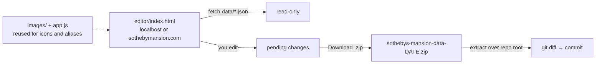

# Data editor

A static page for editing `data/*.json` with the game's own icons instead of
hand-editing JSON. No server, no accounts, no build step.



`data/*.json` stays the single source of truth. The editor edits those files in
memory and hands them back as a download — nothing on the host is ever written.

## What it can and cannot do

| | |
|---|---|
| Reads | `data/*.json`, `app.js` (alias tables), `images/` (icons) |
| Writes to the host | **Nothing.** There is no write API, no upload, no server |
| You get back | A ZIP containing only the files you changed, at their repository paths |
| Credentials | None. No token, no account, no API key |

Everything it reads is already published in the repository, so the page reveals
nothing new. Treat the URL as unlisted rather than secret: it is not a security
boundary, and it does not need to be, because there is nothing to protect.

## Running it

```powershell
python serve.py 8000
```

Then open <http://localhost:8000/editor/index.html>.

`serve.py` is a small wrapper around Python's `http.server` that sends
`Cache-Control: no-store` for html/js/css/json. Without it the browser keeps
serving a cached `app.js` after you edit it, so the page silently runs stale code.
It also prints the app and editor URLs.

If you prefer the stock server, `python -m http.server 8000` works too — just
hard-refresh (Ctrl+Shift+R) after changing any file.

## The workflow

1. Open the editor and make your changes.
2. Check the **Review** tab: it lists validation problems and the exact diff.
3. Press **Download N files (.zip)**.
4. Extract the archive over the repository root — entries are already at
   `data/<name>.json`, so nothing needs renaming or moving.
5. `git diff` to confirm, then commit.

A new psychube icon is a separate download (`<id>.png`): drop it into
`images/psychube_icon/<rarity>/`. The JSON half of that change comes with the ZIP.

## Deployment

The editor is a plain static page, so GitHub Pages serves it as-is. Two things
are worth knowing:

- **The folder is visible in the repository.** Committing `editor/` means anyone
  browsing `github.com/shdemi/sotheby` sees it, and `/editor/index.html` works if
  they guess it. `robots.txt` and a `noindex` meta tag keep it out of search
  results, but that is tidiness, not protection.
- **It is safe to be visible** because it reads only public data and writes
  nothing. If that ever changes — if the editor gains a server, an upload, or a
  credential — revisit this.

`editor/frame.png` is the rarity frame, copied from
`testCodeChube/background.png`. It ships with the editor so the icon import works
without the local tooling folder.

## What it does

| Tab | Covers |
|---|---|
| **Characters** | rarity, afflatus, resonance shape, euphoria (both tiers + CN-only flag), exclude / collab / future-sight flags, CN name, name transfer. Sorted newest first, by ArcanistMap id descending |
| **Psychubes** | name, CN name, release patch, tags, CN-only flag, plus **import a new icon**. Rarity 6 first |
| **Team Presets** | add / delete presets, drag presets and the members inside a variant, per-member euphoria, substitutes with their own psychube and euphoria |
| **Rotations** | the card plan: drag AP slots and skill cards into a round, tag slots, add bracket callouts, mark ultimate cards |
| **Patterns & Skins** | Future Sight skins and name transfer |
| **Review** | validation report and the exact pending diff |

Everything is chosen by clicking icons the app already ships: afflatus sigils,
rarity lines, resonance patterns, psychube art, and character avatars.

The editor knows a character is not one file. Changing a rarity writes
`characters_by_rarity.json`, changing a shape writes `character_reso_shape.json`,
and the **Present in** panel lists every file a character currently appears in.

`shape_patterns.json` / `reso_shape.json` are deliberately **not** editable here:
they are a fixed table that does not change between game updates.

### Ordering

- **Characters**: newest first. The order is ArcanistMap `id` descending, which is
  the same order the app's board uses, so a newly released character appears at
  the top. Characters with no ArcanistMap entry sink to the bottom.
- **Psychubes**: rarity 6 before 5, and newest id first inside each rarity. The
  file itself stores `"5"` before `"6"`; the editor imposes the display order
  rather than following the file.
- **Team presets**: the order in the file, which you control by dragging.

### Team presets

- **+ New preset** creates a preset with one variant and one essential member, so
  the Recommend button has something to protect from the start.
- **Drag the ⠿ handle** on a preset row to reorder. `↑ Up` / `↓ Down` in the
  detail header do the same thing one step at a time.
- **Drag the ⠿ handle** on a member row to move it up or down inside its
  variant. The order is saved as the slot order in `team_archetypes.json`, and
  the drop line shows where the member will land.
- **Euphoria** on a member or a substitute is a `–` / `E1` / `E2` switch.
- **+ Substitute** adds an interchangeable alternative for a slot, with its own
  psychube and euphoria tier.
- A substitute written as a bare string (`"substitutes": ["J"]`) is accepted by
  the app; setting a psychube or euphoria on one rewrites it as an object, because
  the shorthand has nowhere to put the value.

### Rotations (card plan)

The **Cards** button opens a floating palette with three tabs. Everything in it is
dragged into the round, so the round header only keeps the note and the round
actions.

- **AP** holds the slot stamps: **Normal AP**, **OR AP** and **1/4 AP**. Drag one
  onto the thin gap between two cards to insert a slot there. An empty slot shows
  `images/card_modulo/Normal.png`, so the AP order can be laid out before the art
  exists. Dropping a skill card straight into a round inserts a slot already
  filled with it, so the stamp is only needed when the cards are not decided yet.
- **Cards** lists every member's skills plus the special cards. Dropping one on an
  empty slot fills it; dropping it on a filled slot replaces the card; dropping it
  on a gap inserts a new slot.
- **Extra** holds two sections. **Tags** — `AP Free` and `Precast` — are dropped on
  a slot to add or remove them; the tag lives on the slot, not on the card, so one
  slot can carry both. **Frame** — `Normal`, `Ultimate`, `Ramona`,
  `Ramona Ultimate` — is dropped on a card to repaint just that card.
- Hover a card for two switches: **U** toggles between the normal and the ultimate
  frame, **★** marks the preferred side of an OR slot. Skill 3 is treated as an
  ultimate by default, so most cards need no click at all.
- **+ Note** adds a bracket callout that starts out spanning the whole round. The
  row below the strip edits the style (`bracket`, `box`, `fork`), the slot range
  and the text; **Pick** re-picks the range by clicking two cards. Esc cancels the
  pick. Notes whose ranges do not overlap share a lane, so two callouts over
  different cards sit side by side.

Card frames live in `GUIDE_CARD_FRAMES` (`editor/model.js`) and `ROT_CARD_FRAMES`
(`app.js`), one entry per frame:

| Frame | File | Mode |
|---|---|---|
| `normal` | `images/card_modulo/Normal.png` | `inset` — the art is clipped into the plate's inner window |
| `ultimate` | `images/card_modulo/Ultimate.png` | `inset` |
| `ramona-normal` | `images/card_modulo/Frame/Ramona_Normal_Card.png` | `over` — the translucent ornaments sit on top of the art |
| `ramona-ultimate` | `images/card_modulo/Frame/Ramona_Ultimate_Card.png` | `over` |

`inset` frames are opaque in the middle, so the art is drawn **above** them and
clipped to a percentage inset: `Normal.png` uses `left: 1.19% / top: 1.36% /
width: 97.62% / height: 97.74%`, which is its 2px border; `Ultimate.png` uses
`6.32 / 7.30 / 84.74 / 87.30` (x 12–172, y 23–297 of a 190×315 card). `over`
frames invert the stacking, because their middle is translucent.

Adding a frame is one entry: drop the PNG in `images/card_modulo/Frame/`, then add
its key, size and inset to both lists.

Slot tags use the shipped plate art (`Tag_APFree.png`, `Tag_Precast.png`) pinned to
the card's top-left corner. When a slot carries both, the Precast plate sits 3px
below the AP Free badge. `--parchment` is still the app's shared card surface:

```css
--parchment: linear-gradient(to top right, #ddb39f 0%, #d5d3cf 20%, #d5d3cf 80%, #ddb39f 100%);
```

`styles.css` keeps `--team-card-bg: var(--parchment)` as the older name, so
existing rules keep working. Both files declare the token because the editor loads
`editor.css` on its own.

Older rotations may still use `"type": "free"` or `"type": "precast"`. Both are
read as a normal slot plus the matching tag, and the slot is rewritten that way
the first time it is edited — so the data migrates as it is touched, not in one
big rewrite.

### Importing a psychube icon

The game ships psychube art as raw square images. `testCodeChube/compose.py`
composites them onto the rarity frame with Pillow, but that means running Python,
moving `results/` into `images/psychube_icon/<rarity>/`, renaming each file to its
id, and hand-adding the JSON entry.

The editor does the same composite in the browser:

1. Go to **Psychubes** and press **+ New psychube**.
2. Drop the raw art onto the drop zone (248×248 works; any size is centred the
   same way).
3. Pick the rarity, confirm the id (pre-filled with the next free one), and fill
   in the name, CN name, patch and tags.
4. **Add psychube + download icon** composites the icon, downloads it as
   `<id>.png`, and adds the `psychube_id.json` entry to the pending changes. Put
   the PNG in `images/psychube_icon/<rarity>/`; the JSON comes with the ZIP.

The preview shows the source art next to the 180×214 result, so you can see the
composite before downloading.

`icons.js` is a direct port of `compose.py`, and `editor/_test/icon.test.mjs`
compares its output against the icons `compose.py` produced: same 180×214 canvas,
frame centred at y=34, art centred with its top edge at the canvas top, the outer
1px column cleared, and the frame's footer band drawn on top.

> Every shipped icon — 5★ and 6★ alike — uses the same frame. The editor ships it
> as `editor/frame.png`; locally, the frames in `testCodeChube/` are offered as
> alternatives (`_placeholder6/background.png` is a gold variant that is currently
> unused).

## Why the diff stays small

This is the important part.

The shipped data files use **inconsistent formatting** — `ArcanistMap.json` is
4-space, `characters_by_rarity.json` is tab-indented (with one line using spaces),
`future_sight.json` mixes tabs and spaces, and some files end with a newline while
others do not.

A normal "parse then `JSON.stringify`" round trip would reformat the whole file,
so every save would look like a full-file rewrite and reviewing it would be
pointless. `json-patch.js` avoids that: it parses JSON while recording the exact
character range of every value, and edits replace only those ranges.

Two properties are enforced by tests:

1. **Loading without editing changes nothing.** Every one of the 15 files
   round-trips byte-for-byte.
2. **An edit touches only the lines it must.** Changing one field is a one-line
   diff. Appending to a list adds one line, plus a comma on the previous last
   line.

New entries are indented with whatever the *neighbouring* entries use, measured
locally rather than guessed from the file, so a file that mixes tabs and spaces
still gets the right indentation for the list being edited.

## Safety

- **The editor cannot write to the host.** It has no upload, no write API and no
  server; the only output is a ZIP download.
- **Nothing is downloaded until you ask**, and the button is disabled when there
  are no changes.
- **Validation blocks the download** if the result would be a broken file —
  unknown character names, duplicate psychubes, bad tags, unresolvable team
  members, shape patterns out of sync, malformed euphoria entries. Errors must be
  zero; warnings are shown but do not block.
- **Untouched files are not in the archive at all**, so extracting it cannot
  overwrite something you did not change.
- Closing the tab with pending edits prompts first.

`ArcanistMap.json` and `i18n.json` are read-only here: they come from the upstream
game dump and the translator. `shape_patterns.json` and `reso_shape.json` are not
editable either — they are a fixed table.

## Reviewing a change

After extracting the archive:

```powershell
git diff data/
```

You should see only the lines you changed. Then commit.

## Tests

```powershell
npm install          # once: installs playwright for the UI tests
npm test             # all suites
npm run test:ui      # just the browser suite
```

`npm install` is only needed for the UI suite. Everything else runs on plain Node.

| Suite | What it covers |
|---|---|
| `json-patch.test.mjs` | Byte-identical round trip on all 15 files; one-line diffs; append / insert / remove / property edits; **reorderProperty** (moving a preset and moving it back leaves the file byte-identical, and every entry block survives verbatim); indent handling; malformed input; regression tests for separator spacing |
| `zip.test.mjs` | CRC-32 against standard vectors; the archive is opened and verified by **Python's `zipfile`**, an independent implementation; entry paths, store method, timestamps, UTF-8 content and empty input |
| `model.test.mjs` | Derived character view matches the shipped data; newest-first and rarity-6-first ordering; each edit touches only its own file; no-op edits change nothing; team add / move / euphoria / substitutes; psychube add / remove; name transfer; validation catches real mistakes; a full "add a character" session undoes byte-for-byte |
| `icon.test.mjs` | Geometry and frame detection in Node; the browser composite compared against `compose.py`'s output — every difference must be premultiplied-alpha rounding on the art's top edge, never a colour shift or a footer mistake; `editor/frame.png` loads and is the default |
| `e2e.test.mjs` | The save path: copies `data/` to a scratch directory, applies a realistic session, then checks untouched files are byte-identical, diffs stay minimal, and a fresh load sees every change |
| `ui.test.mjs` | Runs the real page in a browser: euphoria buttons, the essential checkbox, substitute euphoria and shape pickers all re-render when clicked; focus survives the re-render; the change reaches the Review diff; no Open folder control exists; noindex is set; **the download really is a ZIP containing the changed file at its repository path**; no console errors |
| `rotation-ui.test.mjs` | The card-plan editor: the round header offers no AP buttons; the palette opens on AP; dropping a stamp inserts an empty slot; dropping a card fills it; a tag toggles on and off; **+ Note** picks a slot range and keeps its text; no page errors |

The UI suite exists because of a bug a model-level test cannot see: the data was
correct and the file was correctly marked dirty, but the control kept its old
highlight because the detail panel was not re-rendered.

Tests avoid depending on one specific character. They pick the first character
that lacks a shape or a CN name, so editing the data does not break them.

## Files

| File | Role |
|---|---|
| `index.html` | Markup for the five tabs and the picker modal |
| `editor.css` | Styling, reusing the app's palette, fonts and icons |
| `json-patch.js` | Range-aware JSON parser and patcher. The core of the small-diff guarantee |
| `model.js` | Data model, name resolution, the derived character view, and validation |
| `icons.js` | Psychube icon compositing — a port of `testCodeChube/compose.py` |
| `frame.png` | The rarity frame, copied from `testCodeChube/background.png` |
| `files.js` | Reading the data and packaging changes as a ZIP download |
| `app.js` | UI: lists, detail forms, icon pickers, drag-reorder, review panel |
